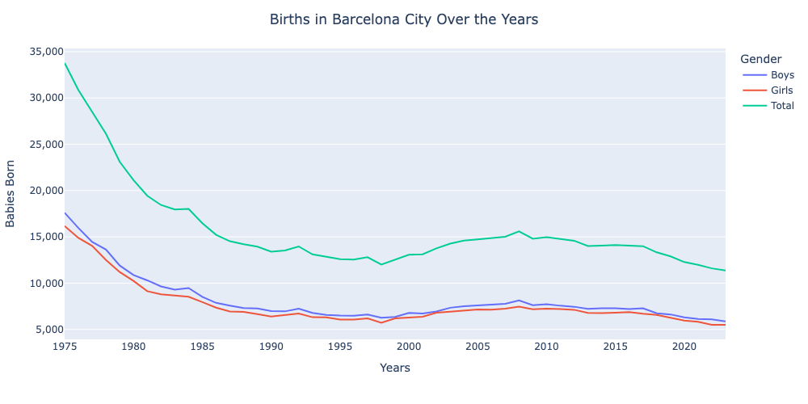

# Preschool Registration in Barcelona

A data story built for the allWomen Data Analysis Bootcamp (Jan to Apr 2025, demo day on April 10th, 2025).

My son was about to start preschool in Barcelona, and that choice shapes the next 9 to 13 years of schooling. I wanted to know how the pre-registration process works and whether the numbers favor families like mine, so I looked at the data. [Full presentation (PDF)](Final%20Project%20DA%20Bootcamp%20-%20Preschool%20Registration%20in%20Barcelona.pdf)

## Questions

1. Has the birth rate in Barcelona dropped?
2. Are there enough P3 places for every child?
3. How many public and private schools are there, and how has that changed?
4. Are there more places in public or private schools, and does it depend on the district?

## Findings

- **Births keep falling.** Barcelona had 15,598 births in 2008 and 11,378 in 2023, a 27.1% drop. Since 1985 the yearly number has never gone above 17,000.
- **Places are shrinking too.** P3 places offered fell from 14,056 in 2017/18 to 11,605 in 2024/25 (-17.4%). Private places fell 20.4% and public places 14.0%.
- **Fewer places than children.** In 2024/25 there were 11,605 places for 11,975 children.
- **The public/private split depends on the district.** Sarrià-Sant Gervasi offers mostly private places, Sant Martí mostly public ones, and Gràcia is close to balanced. Your chances of getting a public or a private place depend on where you live.
- **The school map is changing.** Public schools increased while private ones decreased, partly because several private schools became public between 2019 and 2023.

## Data

| Source | What I used |
|---|---|
| [Idescat](https://www.idescat.cat/) | Births in Barcelona by year and sex, 1975 to 2023 |
| [Dades Obertes de Catalunya](https://analisi.transparenciacatalunya.cat/) | Schools, teachers, offered places and enrollments by district and school type |

The source files are large (some above 100 MB), so they are not stored in this repo. Download them from the portals above.

## Tools

Python (Pandas, NumPy, Matplotlib, Seaborn, Plotly) in Jupyter Notebook for cleaning and EDA. Google Sheets for intermediate tables. Flourish and Canva for the final charts and the presentation.

## Files

- `Final Project_draft2.ipynb`: the analysis notebook
- `Final Project DA Bootcamp - Preschool Registration in Barcelona.pdf`: the presentation

## Next steps

- Go deeper by neighborhood and educational area, not only by district.
- Get the number of applications per school, to estimate the real probability of getting into each one.
